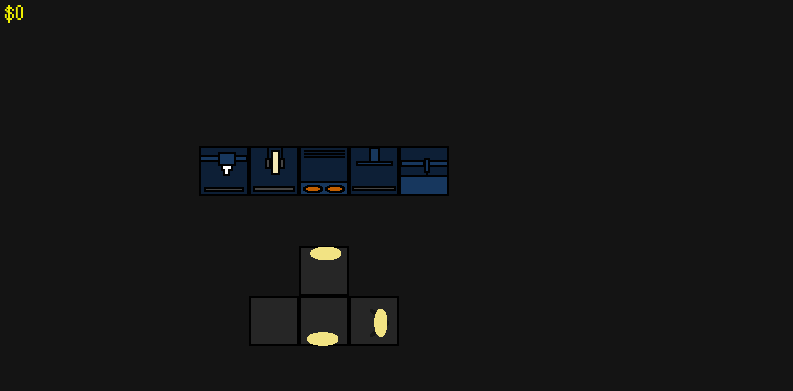
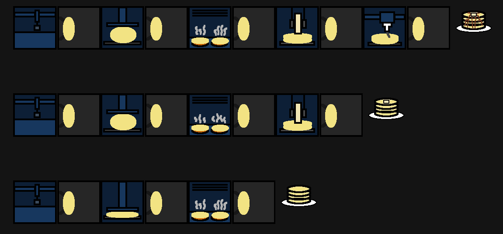
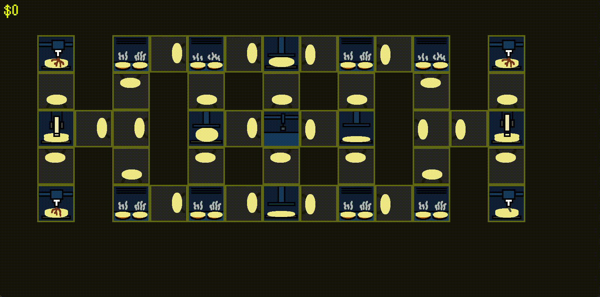

# Flapjackery

Flapjackery is an 8-bit themed game in which you run a factory to industrially produce pancakes!
## How it was made
Flapjackery was made entirely in Python, and heavily utilized the Pygame library for all core functions. The game is made up of two main Python scripts: the main.py script that runs the game and handles all the functions inside the game, and the animhandler.py script that stores all the animation frames and categorizes them into lists that are then accessed by the main script! The music was made with BandLab, and the assets were created with Pixilart.
## How to play
This game is currently in an alpha state, meaning that gameplay is limited and bugs may arise. You can download it by clicking on the latest release (flapjackeryv1.0.0-alpha.2) and downloading "flapjackeryv1.0.0-alpha.2.zip", then extracting it and running "main.exe" without moving any of the other files in the folder. Once you run it, you can right click to place each building type onto the grid. Buildings in an assembly line must be in order for the assembly line to function. The correct order is mixer, press, stove, butter, syrup, however only stove is required to make a valid pancake and syrup and butter each increase the cash earned when the pancake is collected respectively. Left click a pancake to collect it for cash, and drag buildings to move them. Below is an example of each valid minimum assembly line, as well as a gif that demonstrates how multiple conveyers can stem from a single machine to form complex assembly lines.

## Credits
This game relied heavily on the Pygame Python library to function. It was created for the Hack Club Terra challenge.
